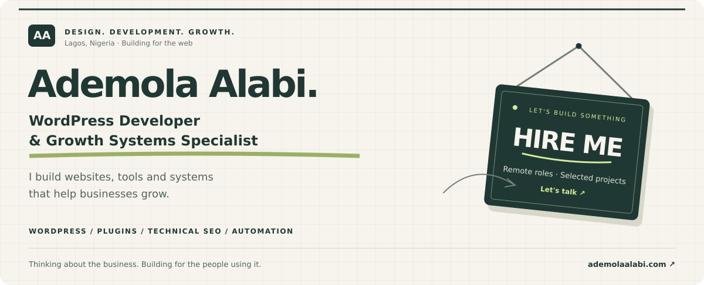

  <a href="https://ademolaalabi.com/"><strong>Portfolio ↗</strong></a> &nbsp; · &nbsp;
  <a href="https://ademolaalabi.com/work/">Selected work ↗</a> &nbsp; · &nbsp;
  <a href="https://ademolaalabi.com/contact/?utm_source=github&utm_medium=profile&utm_campaign=hire_me"><strong>Hire me ↗</strong></a>

### Good websites start with understanding the problem.

I'm Ademola, a WordPress Developer and Growth Systems Specialist based in Lagos, Nigeria. My background spans development, design and marketing, so I care about how a website looks, how it works and what it helps the business achieve.

At Seamless Technologies, I work in marketing across WordPress development, integrations, technical SEO, analytics and performance. Alongside that, I build tools and platforms around problems I encounter in my work and community.

### Things I'm building

| Project | What it's for | Explore |
| :--- | :--- | :--- |
| **FontReady** | Web font preparation and publishing to Elementor Pro. | [Try the tools](https://fontready.com/) · [Plugin source](https://github.com/adealabiid/fontready-wordpress) |
| **TempLogin** · In development | Temporary WordPress access with an expiry and controls for the site owner. | [Follow the build](https://templogin.ademolaalabi.com/) |
| **Yoruba Baptist Hymns** | A digital hymn platform with search, saved hymns and offline features. | [View the case study](https://ademolaalabi.com/work/yoruba-baptist-hymns/) |

### Where I can help

- **WordPress & web development** — custom websites, plugins, Elementor builds and integrations.
- **Technical SEO & performance** — site structure, structured data, migrations and Core Web Vitals.
- **Growth systems** — forms, analytics, CRM connections and marketing automation.

**My toolkit**  
WordPress · PHP · JavaScript · HTML & CSS · Next.js · Elementor · Git  
GA4 · Google Tag Manager · Search Console · Looker Studio · HubSpot · Screaming Frog

---

### Have a role or project in mind?

Tell me what you're building, what needs improving and where you need help.

**[Hire me / Let's talk ↗](https://ademolaalabi.com/contact/?utm_source=github&utm_medium=profile&utm_campaign=hire_me)** &nbsp; · &nbsp; [See my work ↗](https://ademolaalabi.com/work/)

Building with purpose, from Lagos.
